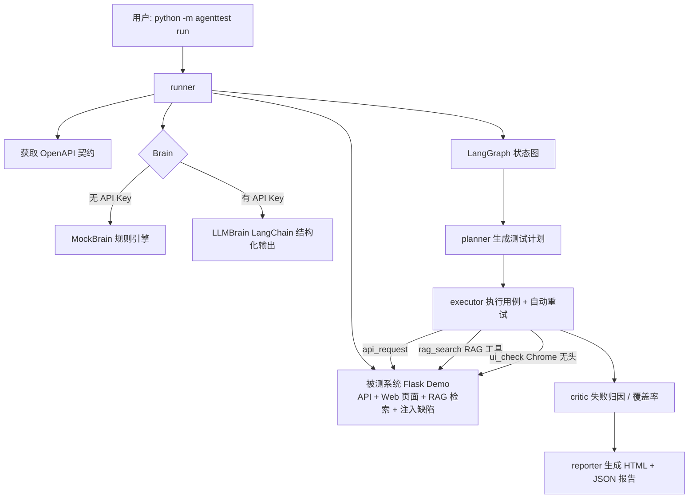
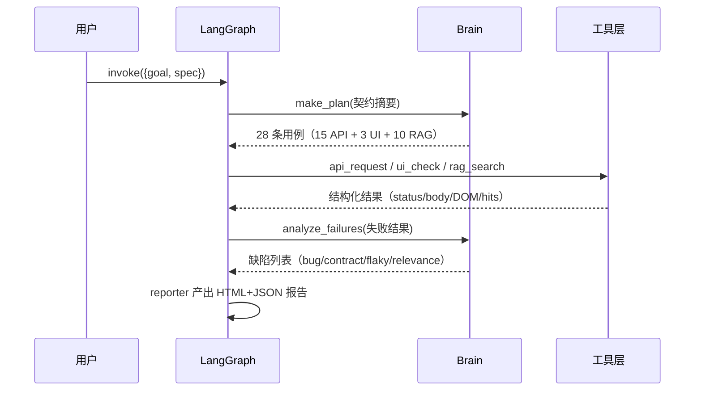

# 🤖 AgentTest Hub — Agent 自动测试系统

> 一个项目，同时打通 **软件测试工程师** 与 **Agent 开发工程师** 两条求职路线。
>
> LangGraph + LangChain 编排的 **API + Web UI + RAG 检索链路** 三覆盖自动化测试系统：Agent 从 OpenAPI 契约生成测试计划、执行测试、自动重试、归因缺陷、产出可视化报告。
>
> 📄 **在线测试报告（GitHub Pages）**：https://lefan17.github.io/agent-test-hub/report.html
>
> 🧪 **配套实践项目**：[software-testing-practice](https://github.com/lefan17/software-testing-practice) —— 契约驱动的接口自动化测试实践：Flask 被测系统 + 27 条登录接口 pytest 用例 + 用例设计/测试报告/SQL 数据校验文档（测试基本功配套仓库）

## 为什么这个项目能同时投两个岗位

| 视角 | 体现的能力 | 对应简历点 |
| --- | --- | --- |
| **软件测试工程师** | 测试用例设计（正/反/边界/契约）、缺陷发现与归因、测试报告、pytest 工程化、OpenAPI 契约测试、Flaky 处理、RAG 检索质量评测（recall@k / MRR） | 接口自动化、UI 自动化、检索评测、测试框架搭建、缺陷管理 |
| **Agent 开发工程师** | LangGraph 状态机编排、LangChain 结构化输出、Tool 抽象与 ReAct 设计、LLM 降级方案、可观测 trace、确定性工具设计 | Agent 框架使用、Prompt 工程、LLM 应用落地、系统设计、RAG 链路工程 |

## 核心特性

- **契约驱动**：从被测系统 `/openapi.json` 读取 OpenAPI 规范，自动生成/推导测试用例
- **API + UI + RAG 三覆盖**：接口断言 + 真实浏览器（Chrome 无头）渲染断言与截图 + 检索链路质量断言（recall@k / MRR / 排序 / 去重 / 索引一致性）
- **检索质量可量化**：RAG 用例产出 recall@k 与 MRR 具体数值写入报告证据，可被 pytest 断言
- **智能缺陷归因**：失败用例由 Brain（LLM 或规则引擎）自动归类为 bug / contract / flaky / environment / relevance
- **自动重试**：对 5xx / 网络异常自动重试（指数退避），区分「不稳定」与「真缺陷」
- **双 Brain 可切换**：`MockBrain`（规则引擎，离线可跑、演示确定性）+ `LLMBrain`（LangChain 结构化输出，接 DeepSeek/OpenAI/通义等）
- **可观测**：报告含 Agent 思考轨迹（trace）、覆盖率、证据与截图
- **自带被测系统**：Flask Demo 应用注入 2 个 API 契约缺陷 + 1 处 Flaky 注入 + 6 个 RAG 检索缺陷开关（覆盖 9 个缺陷面），Agent 演示「发现缺陷」而非「跑一遍全绿」
- **零新增依赖**：RAG 检索默认后端用纯标准库实现 BM25（`demo_app/rag.py`），不引入 rank_bm25 / jieba / numpy 等任何检索库，离线确定性可回归

## 测试套件

```bash
.venv/Scripts/python.exe -m pytest -q            # 115 passed, 15 xfailed, 4 failed
.venv/Scripts/python.exe -m pytest -q --ignore=tests/test_ui_tool.py   # 115 passed, 15 xfailed, 0 failed
```

| 文件 | 条数 | 覆盖 |
| --- | --- | --- |
| `tests/test_demo_app.py` | 15（13 passed + 2 xfail） | 被测系统功能 + 2 项 API 缺陷基准 |
| `tests/test_rag_engine.py` | 38 | BM25 后端、中文分词、排序/去重/索引不变量、检索指标纯函数、标注集指标复现、embedding 降级 |
| `tests/test_rag_tool.py` | 26（18 passed + 8 xfail） | RAG 工具层 + 端点契约缺陷基准（空 q / 非法 top_k / 超长 q 应 400） |
| `tests/test_rag_sut.py` | 30（25 passed + 5 xfail） | RAG 端点功能、语料增删改（含覆盖写入）、索引一致性、并发读写、缺陷复现 + 正确实现对照组 |
| `tests/test_checks.py` | 10 | executor 断言求值层：API 双断言、rag_status、未实现断言必须失败、指数退避 |
| `tests/test_api_tool.py` | 4 | 接口工具集成 |
| `tests/test_mock_brain.py` | 5 | 规划与归因 |
| `tests/test_report.py` | 1 | 报告渲染 |
| `tests/test_runner_e2e.py` | 1 | 端到端（必须发现 contract+bug 缺陷） |
| `tests/test_ui_tool.py` | 4 | UI 工具（**需本机 Chrome，无浏览器环境会失败**） |

15 项 xfail 是**缺陷基准**：用 `@pytest.mark.xfail(strict=True)` 包住「断言契约期望行为」的用例——缺陷存在则 xfail，缺陷被修好会 XPASS 报错提醒更新基准。另有「钉住当前实际行为」的用例直接断言缺陷现状。4 条 UI 失败是已知环境限制（本机无 Chrome），与本次改动无关。

## 架构



## 快速开始（Windows）

> 完整操作手册（安装/运行/配置 LLM/故障排查/二次开发）见 [**docs/操作指南.md**](docs/操作指南.md)

### 1. 环境要求

- Python 3.9+（推荐 3.10+，本项目在 3.12 上验证）
- 本机装有 Chrome 或 Edge（用于 UI 自动化；没有也不影响 API 测试）
- 可选：DeepSeek / OpenAI / 通义等任意 OpenAI 兼容 API Key

### 2. 一键安装并运行

```bash
# Git Bash / WSL / macOS
bash scripts/demo.sh

# Windows CMD / PowerShell 双击即可
scripts\demo.bat
```

或手动执行：

```bash
python -m venv .venv
.venv/Scripts/python.exe -m pip install -r requirements.txt   # Windows
# .venv/bin/python -m pip install -r requirements.txt          # Linux/macOS

.venv/Scripts/python.exe -m agenttest run
```

跑完打开 `reports/report.html` 查看报告。

## 常用命令

```bash
# 全量运行（API + UI + RAG，默认 MockBrain，无需 Key，28 条用例）
.venv/Scripts/python.exe -m agenttest run

# 跳过 UI 用例（25 条：15 API + 10 RAG）
.venv/Scripts/python.exe -m agenttest run --no-ui

# 使用真实 LLM 规划与归因（需配置 Key）
.venv/Scripts/python.exe -m agenttest run --force-llm

# 运行项目自身的测试套件（展示测试功底）
.venv/Scripts/python.exe -m pytest

# 只跑 RAG 检索链路相关测试
.venv/Scripts/python.exe -m pytest tests/test_rag_engine.py tests/test_rag_tool.py tests/test_rag_sut.py
```

## 配置真实 LLM（可选）

复制 `.env.example` 为 `.env` 并填写，或直接设置环境变量：

```bash
export AGENTTEST_LLM_API_KEY=sk-xxxx
export AGENTTEST_LLM_BASE_URL=https://api.deepseek.com/v1   # 以 DeepSeek 为例
export AGENTTEST_LLM_MODEL=deepseek-chat
```

配置后运行 `--force-llm`，Agent 会真正调用 LLM：读取契约摘要 → 结构化生成 12~20 条用例 → 失败结果交给 LLM 归因。未配置 Key 时自动降级 MockBrain，保证离线可演示。

## 被测系统与注入缺陷

`demo_app/` 是一个带缺陷的待办清单服务（Flask），契约在 `demo_app/openapi.json`：

| 缺陷 | 位置 | 契约要求 | 实际行为 |
| --- | --- | --- | --- |
| BUG-API-001 契约不符 | `GET /api/todos?status=invalid` | 400 | 500 |
| BUG-API-002 缺失参数校验 | `POST /api/todos` 空 title | 400 且不落库 | 200 且写入脏数据 |
| FLAKY-001 不稳定服务 | `GET /api/flaky` | 200 | 约 10% 概率 503（触发 Agent 重试） |

另有 RAG 检索链路的 6 个缺陷开关，见下一节。

运行一次演示（`--no-ui`），Agent 实测会发现 11 个缺陷：2 个 API 契约/校验缺陷 + 9 个 RAG 检索缺陷，并在 trace 中展示重试过程。

## RAG 检索链路测试

除 API / UI 之外，本项目还把**检索链路（RAG）**当作一类被测对象：检索质量不能只靠「接口返回 200」判定，必须对召回、排序、去重、索引一致性下断言，并把 recall@k / MRR 这类**可量化指标**写进证据。

### 被测端点（`demo_app/rag.py`，纯标准库 BM25）

| 方法 | 路径 | 说明 |
| --- | --- | --- |
| GET | `/api/rag/search?q=<query>&top_k=<int>` | 返回 `{query, top_k, hits[{doc_id,score,rank,text}], index{backend,size,version}}`；`q` 缺失/为空/超长(>200)、`top_k` 非正/超过上限 50 时返回 400 |
| GET | `/api/rag/index` | 索引与语料元信息：`backend` / `size` / `version` / `doc_ids` / `index_size` |
| POST | `/api/rag/reindex` | 依据当前语料重建索引，返回新的 `version`（验证索引与语料一致性） |
| POST | `/api/rag/docs` | 新增/覆盖语料文档（`doc_id` + `text`，**upsert 语义**：同 `doc_id` 覆盖写入并先清旧倒排项，响应带 `upserted` 标志），返回新 `version`；`openapi.json` 只声明 201/400，没有 409 |
| PATCH / DELETE | `/api/rag/docs/<doc_id>` | 更新 / 删除语料文档（用于验证「删除后仍被召回」这类陈旧索引缺陷） |

默认语料 11 篇：5 篇中文（`DOC-CN-001..005`）+ 4 篇英文（`DOC-EN-001..004`）+ 2 篇精确并列的 `DOC-TIE-001/002`（用于暴露并列排序缺陷）。

**两套后端**：默认 `bm25`（纯标准库实现，离线、确定性、可回归）；另留可选 `embedding` 后端（走 LLM/embedding API，**仅在有 Key 时启用**，依赖延迟导入，缺 Key 或调用失败时自动降级回 BM25 并在 `GET /api/rag/index` 的 `fallback` 字段说明原因）。CI 与演示全程走 BM25，不依赖网络。

### RAG 注入缺陷表（`demo_app/rag.py` 的 `RAG_BUGS`，默认全开）

| 缺陷开关 | 缺陷类别 | 契约要求 | 实际行为 |
| --- | --- | --- | --- |
| `BUG_RAG_CJK_TOKENIZER` | 召回 | 中文查询「向量数据库」应召回 `DOC-CN-002` | 整段连续中文只切一个 token，中文查询召回为 **0** |
| `BUG_RAG_SORT_ASC` | 排序 | `hits` 按 score 降序 | 按 score **升序**返回 |
| `BUG_RAG_NO_TIEBREAK` | 排序 | 分数并列时按 `doc_id` 升序 | 返回 `DOC-TIE-002` 在 `DOC-TIE-001` 之前 |
| `BUG_RAG_DUPLICATE_HITS` | 去重 | 同一 `doc_id` 在 `hits` 中只出现一次 | 多 term 命中同一文档产生重复 hits（`DOC-EN-001` 出现 2 次） |
| `BUG_RAG_STALE_INDEX` | 索引一致性 | 删除文档后不得再被召回 | 倒排索引未同步 → ghost hit，`index_size(12) != size(11)` |
| `BUG_RAG_LOOSE_CONTRACT` | 契约边界 | 空 `q` / 超长 `q` / `top_k<=0` / `top_k>50` 返回 400 | 一律静默修正后返回 200 |

### 检索质量指标定义

- **recall@k** = |top-k 召回的 doc_id ∩ 标注相关 doc_id| / |标注相关 doc_id|（单查询；多查询取算术平均）
- **MRR** = mean(1 / 首个相关文档的 rank)，未召回相关文档时该查询 RR=0

指标由 `agenttest/tools/rag_metrics.py`（纯函数）计算，写入 `TestResult.metrics` 与 `evidence`/`notes`，因此可被 pytest 直接断言。

标注集（7 条查询，4 英文 + 3 中文）就是 `agenttest/tools/rag_metrics.py` 里的 `LABELED_QUERIES` 常量——文档里的数字由它复现，`tests/test_rag_engine.py` 有一条用例专门断言「文档写的 0.5714 / 1.0000 与代码算出来的一致」，防止文档与实现漂移。

实测数值（同一套 7 条查询，`agenttest/tools/rag_metrics.py` 口径，k=5）：

| 实现 | recall@5 | MRR |
| --- | --- | --- |
| 缺陷实现（`RAG_BUGS` 全开，即默认状态） | **0.5714** | **0.5714** |
| 正确实现（`RAG_BUGS` 全关） | **1.0000** | **1.0000** |

差距全部来自 3 条中文查询（「向量数据库」「中文分词质量」「索引重建」）在缺陷实现下召回为 0；4 条英文查询两种实现都命中且排第 1。

### 如何运行 RAG 测试

```bash
# 端到端：报告里会出现 RAG-001..RAG-010，并把检索缺陷归因成 relevance / contract / bug 条目
.venv/Scripts/python.exe -m agenttest run --no-ui

# 只跑新增的 RAG 相关测试
.venv/Scripts/python.exe -m pytest tests/test_rag_engine.py tests/test_rag_tool.py tests/test_rag_sut.py

# 手动验证某个缺陷（ghost hit）
.venv/Scripts/python.exe -c "from demo_app.rag import RagService; s=RagService(); s.add_doc('D1','ghost probe'); s.remove_doc('D1'); print(s.search('ghost probe',5))"
```

Agent 侧新增的 RAG 断言类型：`rag_hits_include` / `rag_rank_monotonic` / `rag_tie_by_doc_id` / `rag_no_duplicate` / `rag_recall_at_least` / `rag_mrr_at_least` / `rag_no_ghost_hit` / `rag_status`，由 `agenttest/graph/nodes.py` 的 RAG 分派分支求值；`Defect.category` 新增 `relevance` 取值承载检索质量类归因。

## 工作原理

### LangGraph 四节点流水线



### 设计要点（面试可直接讲）

1. **Brain 抽象**：`BaseBrain` 协议同时被规则引擎与 LLM 实现——展示「AI 能力可替换」的系统设计，也保证无 Key 时可演示、CI 可回归。
2. **确定性工具层**：Agent 只负责「决策」（规划/归因），执行走确定性代码（requests / Chrome 无头 / BM25 检索），结果可复现——这是测试系统的基本要求。
3. **结构化输出**：LLMBrain 用 `with_structured_output` 把 LLM 输出约束为 Pydantic 模型，杜绝自由文本解析的脆弱性。
4. **可观测性**：每个节点写入 trace，报告呈现完整思考轨迹——调试、演示、面试都能用。
5. **失败重试与归因分离**：5xx/网络错误自动重试（最多 3 次），仍失败才进入 critic 归因，避免把 Flaky 误报成 Bug。
6. **检索质量可量化**：RAG 断言不止看 HTTP 200，而是把 recall@k / MRR / rank 单调 / 并列稳定 / 去重 / ghost hit 变成可断言的指标——「检索效果变差」从主观描述变成可回归的数字。

## 项目结构

```
├─ agenttest/            # Agent 主包
│  ├─ brain/             # MockBrain（规则引擎）/ LLMBrain（LangChain）
│  ├─ graph/             # LangGraph：state / nodes / build
│  ├─ tools/             # api_request / ui_check / fetch_openapi / rag_tool / rag_metrics
│  ├─ report/            # HTML 报告渲染
│  ├─ config.py / models.py / runner.py
├─ demo_app/             # 被测系统（Flask + OpenAPI + RAG 检索 + 注入缺陷）
├─ tests/                # 项目自身 pytest（115 通过 + 15 项缺陷基准 xfail；另有 4 条 UI 用例本机因无 Chrome 失败）
├─ docs/                 # 简历描述 / 面试 QA / 架构文档
├─ scripts/              # demo.bat / demo.sh 一键演示
├─ reports/              # 运行产物（HTML/JSON 报告 + 截图）
└─ requirements.txt / pyproject.toml
```

## 常见问题

- **没有 Chrome 会怎样？** UI 用例会失败并在报告中标注「UI 后端不可用」，API 与 RAG 用例照常；也可 `--no-ui` 跳过。
- **UI 自动化为什么不用 Selenium/Playwright？** 项目默认用系统 Chrome 无头模式（`--dump-dom` + 截图），零驱动零下载；同时内置 Selenium 后端，`--ui-backend selenium` 可切换，体现多方案能力。
- **RAG 为什么要自己实现 BM25？** 为了不引入任何第三方依赖、保证离线确定性可回归；embedding 后端是可选增强，缺 Key 自动降级，不影响 CI。
- **怎么把 MockBrain 换成真 LLM？** 配置 `AGENTTEST_LLM_*` 环境变量后加 `--force-llm`。
- **Python 3.8 能跑吗？** 不行，LangChain/LangGraph 需要 3.9+；本机验证用 Python 3.12。

## License

MIT
