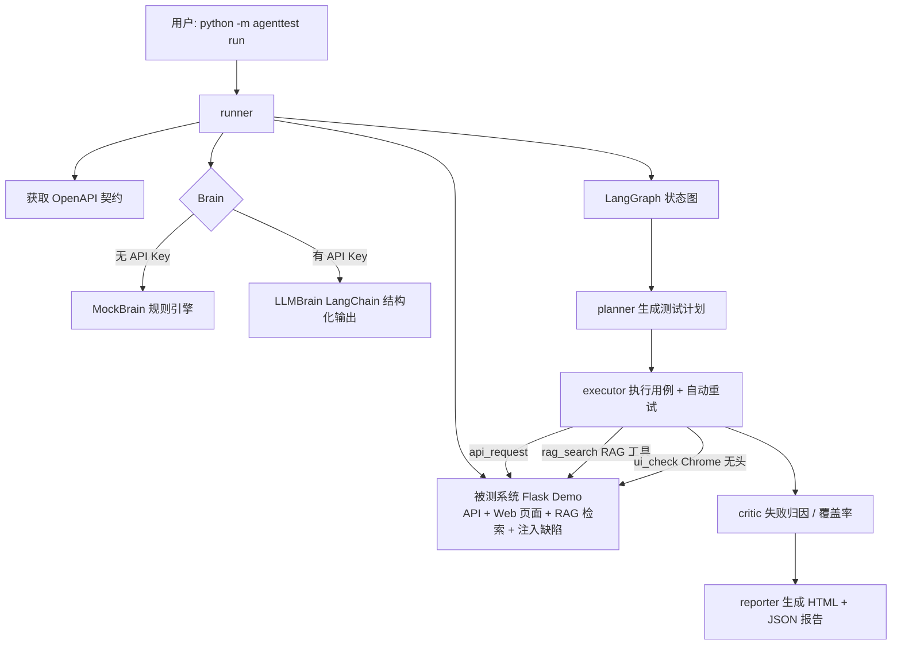
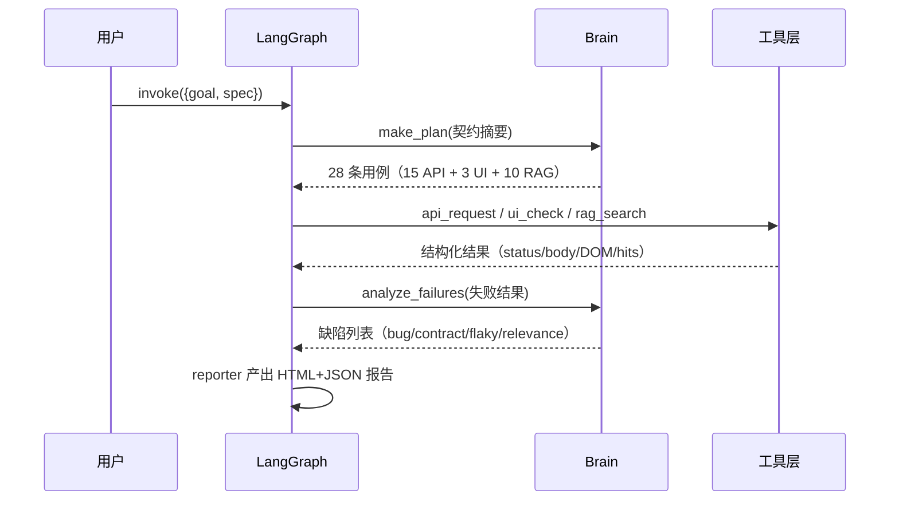

# 🤖 AgentTest Hub — Agent 自动测试系统

> 一个项目，同时打通 **软件测试工程师** 与 **Agent 开发工程师** 两条求职路线。
>
> LangGraph + LangChain 编排的 **API + Web UI + RAG 检索链路** 三覆盖自动化测试系统：Agent 从 OpenAPI 契约生成测试计划、执行测试、自动重试、归因缺陷、产出可视化报告。
>
> 📄 **在线测试报告（GitHub Pages）**：https://lefan17.github.io/agent-test-hub/report.html
>
> 🧪 **配套实践项目**：[software-testing-practice](https://github.com/lefan17/software-testing-practice) —— 契约驱动的接口自动化测试实践：Flask 被测系统 + 27 条登录接口 pytest 用例 + 用例设计/测试报告/SQL 数据校验文档（测试基本功配套仓库）
>
> ✅ **CI**：[](https://github.com/lefan17/agent-test-hub/actions/workflows/test.yml) —— 6 个 job（测试+覆盖率门槛 / mypy+ruff / 容器构建冒烟 / 依赖漏洞扫描 / 提交规范 / 失败通知），触发于 `push` / `pull_request` / 每周夜间回归 `schedule` / `workflow_dispatch`，见 `.github/workflows/test.yml`
>
> 🐳 **容器化**：`docker compose --profile app up`（起被测系统）/ `--profile test up`（跑测试+覆盖率门槛）
>
> 🤝 **协作规范**：见 [CONTRIBUTING.md](CONTRIBUTING.md) · 变更记录见 [CHANGELOG.md](CHANGELOG.md)

> 🧭 **在作品集中的位置**：这条测试 / 质量线上的**第三段**。前两段是
> [fullstack-test-framework](https://github.com/lefan17/fullstack-test-framework)——接口 + UI + 业务全链路
> 自动化测试框架（pytest + FastAPI + Playwright + Allure + CI），负责把执行与断言做扎实；
> 与 [perf-baseline-quality-gate](https://github.com/lefan17/perf-baseline-quality-gate)——性能与稳定性
> 基线平台 + 质量度量与 CI 门禁平台（自研压测引擎、P95/P99 与拐点判定、flaky 识别、12 条门禁规则
> 接入 CI），负责回答"变慢了没有、门禁拦不拦得住"。本仓库接在最后：把**用例生成、执行与缺陷归因
> 交给 LangGraph 编排的 Agent**——接口自动化 → 性能与质量门禁 → Agent 自动测试。

## 为什么这个项目能同时投两个岗位

| 视角 | 体现的能力 | 对应简历点 |
| --- | --- | --- |
| **软件测试工程师** | 测试用例设计（正/反/边界/契约）、缺陷发现与归因、测试报告、pytest 工程化、OpenAPI 契约测试、Flaky 处理、RAG 检索质量评测（recall@k / MRR） | 接口自动化、UI 自动化、检索评测、测试框架搭建、缺陷管理 |
| **Agent 开发工程师** | LangGraph 状态机编排、LangChain 结构化输出、Tool 抽象、LLM 调用失败时的降级与可观测 trace、确定性工具设计 | Agent 框架使用、Prompt 工程、LLM 应用落地、系统设计、RAG 链路工程 |

## 核心特性

- **契约驱动**：从被测系统 `/openapi.json` 读取 OpenAPI 规范并摘要后交给 Brain 生成测试用例；`LLMBrain` 路径按契约生成，`MockBrain` 路径是固定的 28 条模板（不读 spec，保证离线确定性）
- **API + UI + RAG 三覆盖**：接口断言 + 真实浏览器（Chrome 无头）渲染断言与截图 + 检索链路质量断言（recall@k / MRR / 排序 / 去重 / 索引一致性）
- **检索质量可量化**：RAG 用例产出 recall@k 与 MRR 具体数值写入报告证据，可被 pytest 断言
- **智能缺陷归因**：失败用例由 Brain（LLM 或规则引擎）自动归类为 bug / contract / flaky / environment / test_issue / relevance 六类。规则引擎覆盖全部六类：四类由 HTTP 语义映射（400→500 契约不符 / 400→200 校验缺失 / 503 flaky / 没拿到任何响应→environment），`test_issue` 与 `relevance` 分别兜 API 与 RAG 的其余失败
- **自动重试**：对 5xx / 网络异常自动重试（指数退避），区分「不稳定」与「真缺陷」
- **双 Brain 可切换**：`MockBrain`（规则引擎，离线可跑、演示确定性）+ `LLMBrain`（LangChain 结构化输出，接 DeepSeek/OpenAI/通义等）
- **可观测**：报告含 Agent 思考轨迹（trace）、覆盖率、缺陷证据与截图（截图仅在 UI 用例真正跑通时产生）、以及「本轮是否降级为规则引擎」的显式声明
- **自带被测系统**：Flask Demo 应用注入 2 个 API 契约缺陷 + 1 处 Flaky 注入 + 6 个 RAG 检索缺陷开关（覆盖 9 个缺陷面），Agent 演示「发现缺陷」而非「跑一遍全绿」
- **零新增依赖**：RAG 检索默认后端用纯标准库实现 BM25（`demo_app/rag.py`），不引入 rank_bm25 / jieba / numpy 等任何检索库，离线确定性可回归
- **企业级工程化外壳**：容器化（Dockerfile + compose 双 profile）、覆盖率门槛（实测分支覆盖 76.88% / 门槛 70%）、mypy 全绿、ruff、pip-audit 漏洞扫描 + Dependabot、依赖锁文件（pip-tools）、pre-commit、Conventional Commits 门禁（commitlint + 零依赖 Python 替代）、Issue/PR 模板、CODEOWNERS、环境分层（dev/staging/prod）——见 [工程化能力](#工程化能力)

## 工程化能力

> 这一节是**面试可追问**的部分：每一项都给出「怎么用」与「为什么这么做」，以及**哪些尚未在本机验证**。

| 能力 | 落地位置 | 怎么用 |
| --- | --- | --- |
| 容器化 | `Dockerfile`、`docker-compose.yml` | `docker compose --profile app up --build` / `--profile test up --build` |
| 覆盖率门槛 | `pyproject.toml [tool.coverage.*]`、CI `test` job | `--cov=agenttest --cov=demo_app --cov-fail-under=70` |
| 静态类型 | `pyproject.toml [tool.mypy]`、CI `lint` job | `python -m mypy` → `Success: no issues found in 24 source files` |
| 代码规范 | `pyproject.toml [tool.ruff]`、CI `lint` job、pre-commit | `python -m ruff check .` → `All checks passed!` |
| 漏洞扫描 | `.github/dependabot.yml`、CI `security` job | `pip-audit -r requirements.lock`（**非阻塞**，理由见下） |
| 依赖锁文件 | `requirements.lock`（pip-tools 生成）、CI `lint` job 的格式校验步骤 | `python -m piptools compile requirements.txt -o requirements.lock` |
| 依赖分层 | `requirements.txt`（运行）/ `requirements-dev.txt`（工程化） | 镜像用 `ARG INSTALL_DEV=0/1` 切换 |
| 本地钩子 | `.pre-commit-config.yaml` | `python -m pre-commit run --all-files` |
| 提交规范 | `commitlint.config.mjs`、`.husky/commit-msg`、`scripts/check_commit_msg.py` | 见 [CONTRIBUTING.md](CONTRIBUTING.md#3-提交信息规范conventional-commits) |
| 协作模板 | `.github/PULL_REQUEST_TEMPLATE.md`、`.github/ISSUE_TEMPLATE/`、`CODEOWNERS` | 开 PR / issue 时自动带出 |
| 环境分层 | `scripts/env/{dev,staging,prod}.env`、`agenttest/config.py` | `AGENTTEST_ENV=staging python -m agenttest run` |
| CI 定时与并发 | `.github/workflows/test.yml` `on.schedule` / `concurrency` | 每周日 19:00 UTC 夜间回归；同 ref 自动取消旧运行 |
| CI 失败通知 | CI `notify` job | **零 secret**：写 step summary + 用内置 `GITHUB_TOKEN` 自动开 issue（仅 `push` / `schedule` 失败时；PR 失败不开，理由见下） |

### 覆盖率

实测命令与结果（本机 `.venv`，Python 3.12.10）：

```bash
# 仓库默认配置（pyproject 里 branch = true）：TOTAL 1500 stmts / 311 miss / 420 branch = 76.88%
.venv/Scripts/python.exe -m pytest -o addopts= -q --ignore=tests/test_ui_tool.py \
    --cov=agenttest --cov=demo_app --cov-report=term-missing

# 对照：关掉分支覆盖（临时 --cov-config，内容只有 [run] branch = false）
#   → TOTAL 1505 stmts / 315 miss = 79.07%
# 分支覆盖默认比语句覆盖低约 2.2 个百分点，换来的信息量更大，因此默认开着。
```

**CI 门槛取 70**，理由：低于两条实测口径（语句覆盖 79.07% / 分支覆盖 76.88%），留约 6.9 个百分点的余量以容纳正常重构。这个门槛能拦住什么、拦不住什么，按当前总数（1500 语句 + 420 分支）反推如下——**实测口径，不是估算**：

| 假设的退化 | 反推覆盖率 | 是否击穿 70 |
| --- | --- | --- |
| `agenttest/graph/nodes.py`（254 行）整体失去覆盖 | 60.5% | ✅ 拦得住 |
| `demo_app/rag.py`（264 行）整体失去覆盖 | 62.6% | ✅ 拦得住 |
| `demo_app/app.py`（180 行）整体失去覆盖 | 66.7% | ✅ 拦得住 |
| `agenttest/brain/llm_brain.py`（110 行）整体失去覆盖 | 70.7% | ❌ 拦不住 |

**诚实结论：70 这个门槛能拦住「大模块整体失守」（上表三个都拦得住），但拦不住单个中小模块的完全失守（`llm_brain.py` 丢掉全部 110 行仍剩 70.7%）。** 之所以不往上抬：那会把门槛压到分支口径实测值（76.88%）之上，CI 首次运行就是红的，只能靠删测试或写无意义测试来凑，属于自欺。真正能拦住单模块退化的手段是**每文件门槛**（`[tool.coverage.report]` 的 per-file `fail_under`，或 Codecov 的 patch coverage），本仓库尚未启用，已记入 CHANGELOG 的 Unreleased 段作为后续任务。

> 门槛还刻意留出了抖动幅度：`demo_app/rag.py` 有一个 10% 概率返回 503 的注入缺陷（`FLAKY-001`）。本机连跑 5 次：4 次 **76.88%**、1 次 **76.98%**（差 2 行覆盖；抖动方向与重试路径一致，但未单独验证归因），但门槛取 70 也是为了在这种抖动真的出现时不至于间歇性变红——间歇性红最终一定会被人用重跑糊过去。

覆盖率短板（`--cov-report=term-missing` 实测，按缺失语句数排序）：

| 文件 | 覆盖 | 未覆盖的原因 |
| --- | --- | --- |
| `agenttest/runner.py` | **0%**（122 行全未覆盖） | CLI 入口与退出路径。测试套件直接调用 `build_context()`/图节点，不 fork 子进程跑 CLI |
| `agenttest/config.py` | 39% | 环境分层的档案读取与 `pick_int` 异常分支：既有测试不设置 `AGENTTEST_ENV`/`AGENTTEST_MAX_ATTEMPTS`，走不到 |
| `agenttest/tools/ui_tool.py` | 78% | Chrome 无头 / Selenium 分支：本条覆盖率口径是 `--ignore=tests/test_ui_tool.py`，UI 用例被排除在外；在禁止创建子进程的环境里 Chrome 也起不来，两条分支都走不到 |
| `agenttest/tools/spec_tool.py` | 32% | 需要真实 HTTP 拉取 `/openapi.json`；端到端用例只覆盖了它的一部分 |
| `agenttest/brain/llm_brain.py` | 84% | 联网调用与结构化解析那几行；失败降级路径与缺陷关联用例的白名单/兜底都有单测覆盖（见 `tests/test_llm_brain.py`） |

其余模块普遍 80%~100%（`models.py`、`rag_metrics.py`、`graph/*` 均接近满分）。`agenttest/__main__.py` 是 3 行 CLI 薄壳，已在 `[tool.coverage.run] omit` 中排除——单独跑它没有断言价值。

上面这几处都属于「需要外部条件（CLI 子进程 / 特定环境变量 / 联网 / 真实浏览器）才能覆盖」，是**已知缺口而非遗漏**，也正是门槛取 70 而不是 90 的原因：把门槛定到实际够不到的位置，只会逼出「为凑数字而写无意义测试」。

### 为什么 pip-audit 是非阻塞的

它查的是**外部漏洞库**，不是本仓库的代码质量。同一条正确无误的提交，可能今天全绿、明天因为某个依赖被披露新 CVE 而变红；设成阻塞会让「与本次改动无关的失败」卡住所有人的 PR。所以：结果照跑、照进日志与 step summary 与 artifact，但不阻断；真正需要强迫升级时由 Dependabot 自动开 PR。

### ⚠️ 本机未验证项（诚实声明）

| 项 | 状态 | 原因 |
| --- | --- | --- |
| `docker build` / `docker run` | **未验证** | 本机 Docker daemon 无法启动（WSL `E_ACCESSDENIED`）。`Dockerfile` 与 `docker-compose.yml` **只通过 `docker compose --profile '*' config --quiet` 静态校验（EXIT=0）**，从未真实构建或运行。真实构建与冒烟由 CI 的 `container` job 承担。 |
| `pip-audit` | **未验证** | 需创建临时虚拟环境，沙箱拒绝 `ensurepip`（`PermissionError: [WinError 5]`）；且它把缓存写死在 `%LOCALAPPDATA%\pip-audit`，`--cache-dir` 也绕不过。仅在 CI 的 `security` job 里被真实验证。配置已就位，本地从未跑通。 |
| `pre-commit` | **未验证** | 同上（hook 需要独立虚拟环境）。配置仅通过 `yaml.safe_load` 静态语法校验；等价检查由 CI 的 `lint` job 承担。 |
| `commitlint` 完整 CLI | **未验证** | `npm install` 已走本机代理成功（`node_modules/` 存在），`commitlint.config.mjs` 的语法与规则已用真实 `@commitlint/load` + `@commitlint/lint` 验证（7 个用例全部符合预期）。但 commitlint CLI 会 spawn `git` 取提交信息，沙箱命名管道限制让 `spawn` 报 `Error: spawn EPERM`——沙箱边界，非配置问题。`.husky/commit-msg` 同样未真实触发。CI 的 `commit-msg` job 覆盖同一份规则。 |
| `requirements-dev.txt` 钉的两个版本 | **无法核对** | `pre-commit==4.3.0` 与 `commitizen==4.9.1` **本机从未安装过**（沙箱拒绝建 venv），版本号无法核对。其余六个包（pytest-cov / coverage / ruff / mypy / pip-audit / pip-tools）已用 `importlib.metadata` + `pip show` 双口径实测，**与钉版逐条一致**（详见该文件顶部核对表）。另：本机这三个包是从同机另一个 3.12 venv 复制到 `site-packages` 的，不是 `pip install` 进来的——「覆盖率 76.88%」「ruff 全绿」是真跑出来的，但 CI 能否解析安装这些版本号，只能等 CI 首次运行。 |


## 测试套件

采集数 **180**（不含 UI 时 176 = 161 passed + 15 xfailed；含 UI 另加 4 条需真实浏览器的用例）。以下数字均为**本机实测**（PowerShell 5.1 / Python 3.12.10）：

```bash
# 全量（含 UI）：其中 4 条依赖真实浏览器，能启动 Chrome 子进程时全部通过
# （在禁止创建子进程的环境里这 4 条会失败，与代码无关，故 CI 那一步设了 continue-on-error）
.venv/Scripts/python.exe -m pytest -q            # 165 passed, 15 xfailed

# 不含 UI：CI 的阻塞口径
.venv/Scripts/python.exe -m pytest -q --ignore=tests/test_ui_tool.py   # 161 passed, 15 xfailed, 0 failed

# 带覆盖率门槛（CI test job 同一条命令）
.venv/Scripts/python.exe -m pytest -o addopts= -q --ignore=tests/test_ui_tool.py \
    --cov=agenttest --cov=demo_app --cov-report=term-missing --cov-fail-under=70
#   → 161 passed, 15 xfailed, 1 warning；TOTAL 1500 stmts / 311 miss / 420 branch = 76.88%
#   → Required test coverage of 70.0% reached.
```

> `-o addopts=` 不能省：`pyproject.toml` 里 `addopts = "-q"`，而 `-q` 会把末尾的 `161 passed, ...` 汇总行一起吞掉；命令行覆盖为空之后计数才会出现在输出与 CI 日志里。

| 文件 | 条数 | 覆盖 |
| --- | --- | --- |
| `tests/test_demo_app.py` | 15（13 passed + 2 xfail） | 被测系统功能 + 2 项 API 缺陷基准 |
| `tests/test_rag_engine.py` | 39 | BM25 后端、中文分词、排序/去重/索引不变量、检索指标纯函数、标注集指标复现、embedding 降级 |
| `tests/test_rag_tool.py` | 26（18 passed + 8 xfail） | RAG 工具层 + 端点契约缺陷基准（空 q / 非法 top_k / 超长 q 应 400） |
| `tests/test_rag_sut.py` | 30（25 passed + 5 xfail） | RAG 端点功能、语料增删改（含覆盖写入）、索引一致性、并发读写、缺陷复现 + 正确实现对照组 |
| `tests/test_checks.py` | 19 | executor 断言求值层：API 双断言、rag_status、未实现断言必须失败（RAG/API/UI 三处）、指数退避 |
| `tests/test_llm_brain.py` | 10 | LLM 调用失败 / 畸形输出 / 空计划时必须降级为规则引擎而不是崩掉；缺陷关联用例的白名单过滤与同 kind 兜底（用假 `_chat` 注入，不需要真 Key） |
| `tests/test_rag_coverage.py` | 8 | coverage 端点映射：声明表 vs `rag_tool` 真实调用记录（谁加了端点没同步声明就变红）、API/UI 键语义不变 |
| `tests/test_rag_eval.py` | 14 | 评测集端到端判阈值：空标注 / 被测量缺失 / 服务正常但召回为 0 都必须判失败，正确实现判通过 |
| `tests/test_api_tool.py` | 4 | 接口工具集成 |
| `tests/test_mock_brain.py` | 7 | 规划与归因 |
| `tests/test_report.py` | 3 | 报告渲染（含「降级必须在报告里可见」） |
| `tests/test_runner_e2e.py` | 1 | 端到端（必须发现 contract+bug 缺陷） |
| `tests/test_ui_tool.py` | 4 | UI 工具（**需能真正启动的 Chrome**；在禁止创建子进程的环境里这 4 条会失败，与代码无关） |

15 项 xfail 是**缺陷基准**：用 `@pytest.mark.xfail(strict=True)` 包住「断言契约期望行为」的用例——缺陷存在则 xfail，缺陷被修好会 XPASS 报错提醒更新基准。另有「钉住当前实际行为」的用例直接断言缺陷现状。4 条 UI 用例的结果取决于运行环境：本机**装了** Chrome（`C:\Program Files\Google\Chrome\Application\chrome.exe`），能启动 Chrome 子进程时 4 条全部通过（即上面的 165 passed）；在禁止创建子进程的环境里它们会以 failed 收场（例如 `crashpad_client_win.cc:430 OpenProcess: 拒绝访问 (0x5)`），与代码无关，因此 CI 里那条全量命令设了 `continue-on-error`。

## 架构



## 快速开始（Windows）

> 完整操作手册（安装/运行/配置 LLM/故障排查/二次开发）见 [**docs/操作指南.md**](docs/操作指南.md)

### 1. 环境要求

- Python 3.9+（推荐 3.10+，本项目在 3.12 上验证）
- 本机装有 Chrome 或 Edge（用于 UI 自动化；没有也不影响 API 测试）
- 可选：DeepSeek / OpenAI / 通义等任意 OpenAI 兼容 API Key

### 2. 一键安装并运行

```bash
# Git Bash / WSL / macOS
bash scripts/demo.sh

# Windows CMD / PowerShell 双击即可
scripts\demo.bat
```

或手动执行：

```bash
python -m venv .venv
# 只跑被测系统 → 装运行依赖即可
.venv/Scripts/python.exe -m pip install -r requirements.txt   # Windows
# .venv/bin/python -m pip install -r requirements.txt          # Linux/macOS

# 要跑测试 / 覆盖率 / mypy / ruff → 装工程化依赖（它已用 -r 引用上面那份）
.venv/Scripts/python.exe -m pip install -r requirements-dev.txt

.venv/Scripts/python.exe -m agenttest run
```

跑完打开 `reports/report.html` 查看报告。

## 常用命令

```bash
# 全量运行（API + UI + RAG，默认 MockBrain，无需 Key，28 条用例）
.venv/Scripts/python.exe -m agenttest run

# 跳过 UI 用例（25 条：15 API + 10 RAG）
.venv/Scripts/python.exe -m agenttest run --no-ui

# 使用真实 LLM 规划与归因（需配置 Key）
.venv/Scripts/python.exe -m agenttest run --force-llm

# 运行项目自身的测试套件（展示测试功底）
.venv/Scripts/python.exe -m pytest

# 带覆盖率门槛（CI test job 的同一条命令）
.venv/Scripts/python.exe -m pytest -o addopts= -q --ignore=tests/test_ui_tool.py \
    --cov=agenttest --cov=demo_app --cov-report=term-missing --cov-fail-under=70

# 静态检查（与 CI lint job 完全一致）
.venv/Scripts/python.exe -m mypy            # 需先 pip install -r requirements-dev.txt
.venv/Scripts/python.exe -m ruff check .

# 切到 staging 配置档案（被测系统指向 5002、UI 后端固定 selenium、报告写 reports/staging）
AGENTTEST_ENV=staging .venv/Scripts/python.exe -m agenttest run

# 只跑 RAG 检索链路相关测试
.venv/Scripts/python.exe -m pytest tests/test_rag_engine.py tests/test_rag_tool.py tests/test_rag_sut.py
```

## 环境分层（dev / staging / prod）

`AGENTTEST_ENV` 选择一套配置档案，档案文件在 `scripts/env/<profile>.env`：

| 档案 | 被测系统 | UI 后端 | 报告目录 | 说明 |
| --- | --- | --- | --- | --- |
| `dev`（默认） | `http://127.0.0.1:5001` | `auto` | `reports` | 本地开发，**取值与代码默认值逐条一致** |
| `staging` | `http://127.0.0.1:5002` | `selenium` | `reports/staging` | 预发/联调，与 dev 实例并存不冲突 |
| `prod` | 生产地址（占位） | `selenium` | `reports/prod` | 只读契约验证，重试收紧到 1 次，报告独立归档 |

**取值优先级（从高到低）：真实环境变量（含 `.env`）> 档案文件 > 代码默认值。**

关键设计：`scripts/env/dev.env` 的每个值都与 `agenttest/config.py` 的代码默认值一致，因此**不设置 `AGENTTEST_ENV`（也不设任何相关环境变量）时的行为，与引入环境分层之前完全相同**——已由既有 121 条测试回归确认。`AGENTTEST_ENV` 写成非法值会直接 `ValueError`（明确报错优于静默跑错环境），而不是悄悄回落到 dev。

LLM Key 一律只写进 `.env` 或真实环境变量，**绝不写进档案文件**（档案文件是入库的，见 `scripts/env/prod.env` 顶部的说明）。

## 容器化

```bash
# 静态校验（不需要 daemon，CI 的 container job 第一步就是它）
# ⚠️ 必须带 --profile '*'：两个 service 都挂了 profiles，不带 profile 时
#    config 会把它们全过滤掉，退化成 `services: {}` 却依然 EXIT=0。
docker compose --profile '*' -f docker-compose.yml config --quiet

# 路径一：只起被测系统 → http://127.0.0.1:5001
docker compose --profile app up --build demo-app

# 路径二：只跑项目测试套件（含覆盖率门槛，等价 CI 的 test job）
docker compose --profile test up --build --abort-on-container-exit tests

# 两条一起（测试会等 demo-app healthy 之后再启动）
docker compose --profile app --profile test up --build
```

镜像基于 `python:3.12-slim`（与 CI 及本机 `.venv` 的 3.12 对齐，避免版本漂移）。`Dockerfile` 用 `ARG INSTALL_DEV` 区分两批依赖：`0` 只装 `requirements.txt`（起被测系统），`1` 额外装 `requirements-dev.txt`（跑测试与覆盖率）。依赖层与源码层分离，改代码不会让依赖层缓存失效。

**容器内必须绑 `0.0.0.0`**：`demo_app/app.py:305` 原本写死 `host="127.0.0.1"`，那在容器里是**容器自身的回环**，宿主经 `-p 5001:5001` 转发进来的连接会被容器网络栈直接 reset，表现为 `curl: (56) Recv failure: Connection reset by peer`——容器日志却显示 `* Running on http://127.0.0.1:5001`，看起来一切正常。现在该行读 `os.getenv("AGENTTEST_BIND_HOST", "127.0.0.1")`，默认值与改动前**逐字符一致**，只有 `Dockerfile` 与 `docker-compose.yml` 显式注入 `AGENTTEST_BIND_HOST=0.0.0.0`。已在本机用 `netstat -ano` 实测两侧都符合预期：

```
不设该变量           → TCP 127.0.0.1:5001 LISTENING
AGENTTEST_BIND_HOST=0.0.0.0 → TCP 0.0.0.0:5001   LISTENING
```

CI 的冒烟步骤也据此改成**双段探活**（`docker exec` 查容器内 + `curl` 查宿主侧），失败时能直接区分「服务没起来」与「服务起来了但宿主不可达」，而不是只丢一句 reset。

**构建上下文**由 `.dockerignore` 收窄：排除 `.git/`（完整历史）、`.venv/`（数百 MB）、`__pycache__/`、各类工具缓存、`reports/`、`.tmp/`，以及 `.env*`——后者可能含 `AGENTTEST_LLM_API_KEY`，而**镜像层里删掉的文件依然留在历史层里**，必须在上下文阶段就挡掉。`.dsh-vision-router/`（本机调试截图，文件名还编码了本机绝对路径）同样排除，它不该出现在任何产物中。刻意**不排除** `README.md` / `LICENSE` / `pyproject.toml`：`pyproject.toml` 声明了 `readme = "README.md"`，将来若加 `pip install .`，缺这些文件会直接构建失败。

> ⚠️ `docker compose config --quiet` 只能校验**编排文件语法**，证明不了任何一层是否真的能装上、能不能跑起来——那是 `container` job 在 CI 上做的事。本地从未构建过镜像。

**为什么必须 `python -m pytest` 而不是裸 `pytest`**：镜像里没有 `pip install -e .`，`demo_app/` 不在 `site-packages`。裸 `pytest` 不会把 WORKDIR 加进 `sys.path`，容器内会直接 `ModuleNotFoundError: No module named 'demo_app'`——与 CI 那条坑是同一回事。

> ⚠️ **本机未验证**：本开发沙箱的 Docker daemon 无法启动（WSL `E_ACCESSDENIED`）。`Dockerfile` 与 `docker-compose.yml` **只做过 `docker compose --profile '*' config --quiet` 静态校验（EXIT=0），从未真实 `docker build` 或 `docker run`**。真实构建 + 探活冒烟由 CI 的 `container` job 承担（`docker/build-push-action` 构建两个镜像，运行镜像探 `/openapi.json`，测试镜像内跑测试套件）。
>
> 另需说明这条静态校验的**实际强度**：它只证明「YAML 语法合法 + 变量插值能求值 + service 定义结构正确」，**证明不了**镜像能不能装上依赖、容器能不能起来。而且不带 `--profile '*'` 时它会退化成校验 `services: {}`——同样 EXIT=0，属于假绿。


## 配置真实 LLM（可选）

复制 `.env.example` 为 `.env` 并填写，或直接设置环境变量：

```bash
export AGENTTEST_LLM_API_KEY=sk-xxxx
export AGENTTEST_LLM_BASE_URL=https://api.deepseek.com/v1   # 以 DeepSeek 为例
export AGENTTEST_LLM_MODEL=deepseek-chat
```

配置后运行 `--force-llm`，Agent 会真正调用 LLM：读取契约摘要 → 结构化生成 12~20 条用例 → 失败结果交给 LLM 归因。未配置 Key 时自动降级 MockBrain，保证离线可演示。

## 被测系统与注入缺陷

`demo_app/` 是一个带缺陷的待办清单服务（Flask），契约在 `demo_app/openapi.json`：

| 缺陷 | 位置 | 契约要求 | 实际行为 |
| --- | --- | --- | --- |
| BUG-API-001 契约不符 | `GET /api/todos?status=invalid` | 400 | 500 |
| BUG-API-002 缺失参数校验 | `POST /api/todos` 空 title | 400 且不落库 | 200 且写入脏数据 |
| FLAKY-001 不稳定服务 | `GET /api/flaky` | 200 | 约 10% 概率 503（触发 Agent 重试） |

另有 RAG 检索链路的 6 个缺陷开关，见下一节。

运行一次演示（`--no-ui`），Agent 实测会发现 11 个缺陷：2 个 API 契约/校验缺陷 + 9 个 RAG 检索缺陷，并在 trace 中展示重试过程。

## RAG 检索链路测试

除 API / UI 之外，本项目还把**检索链路（RAG）**当作一类被测对象：检索质量不能只靠「接口返回 200」判定，必须对召回、排序、去重、索引一致性下断言，并把 recall@k / MRR 这类**可量化指标**写进证据。

### 被测端点（`demo_app/rag.py`，纯标准库 BM25）

| 方法 | 路径 | 说明 |
| --- | --- | --- |
| GET | `/api/rag/search?q=<query>&top_k=<int>` | 返回 `{query, top_k, hits[{doc_id,score,rank,text}], index{backend,size,version}}`；`q` 缺失/为空/超长(>200)、`top_k` 非正/超过上限 50 时返回 400 |
| GET | `/api/rag/index` | 索引与语料元信息：`backend` / `size` / `version` / `doc_ids` / `index_size` |
| POST | `/api/rag/reindex` | 依据当前语料重建索引，返回新的 `version`（验证索引与语料一致性） |
| POST | `/api/rag/docs` | 新增/覆盖语料文档（`doc_id` + `text`，**upsert 语义**：同 `doc_id` 覆盖写入并先清旧倒排项，响应带 `upserted` 标志），返回新 `version`；`openapi.json` 只声明 201/400，没有 409 |
| PATCH / DELETE | `/api/rag/docs/<doc_id>` | 更新 / 删除语料文档（用于验证「删除后仍被召回」这类陈旧索引缺陷） |

默认语料 11 篇：5 篇中文（`DOC-CN-001..005`）+ 4 篇英文（`DOC-EN-001..004`）+ 2 篇精确并列的 `DOC-TIE-001/002`（用于暴露并列排序缺陷）。

**两套后端**：默认 `bm25`（纯标准库实现，离线、确定性、可回归）；另留可选 `embedding` 后端（走 LLM/embedding API，**仅在有 Key 时启用**，依赖延迟导入，缺 Key 或调用失败时自动降级回 BM25 并在 `GET /api/rag/index` 的 `fallback` 字段说明原因）。CI 与演示全程走 BM25，不依赖网络。

### RAG 注入缺陷表（`demo_app/rag.py` 的 `RAG_BUGS`，默认全开）

| 缺陷开关 | 缺陷类别 | 契约要求 | 实际行为 |
| --- | --- | --- | --- |
| `BUG_RAG_CJK_TOKENIZER` | 召回 | 中文查询「向量数据库」应召回 `DOC-CN-002` | 整段连续中文只切一个 token，中文查询召回为 **0** |
| `BUG_RAG_SORT_ASC` | 排序 | `hits` 按 score 降序 | 按 score **升序**返回 |
| `BUG_RAG_NO_TIEBREAK` | 排序 | 分数并列时按 `doc_id` 升序 | 返回 `DOC-TIE-002` 在 `DOC-TIE-001` 之前 |
| `BUG_RAG_DUPLICATE_HITS` | 去重 | 同一 `doc_id` 在 `hits` 中只出现一次 | 多 term 命中同一文档产生重复 hits（`DOC-EN-001` 出现 2 次） |
| `BUG_RAG_STALE_INDEX` | 索引一致性 | 删除文档后不得再被召回 | 倒排索引未同步 → ghost hit，`index_size(12) != size(11)` |
| `BUG_RAG_LOOSE_CONTRACT` | 契约边界 | 空 `q` / 超长 `q` / `top_k<=0` / `top_k>50` 返回 400 | 一律静默修正后返回 200 |

### 检索质量指标定义

- **recall@k** = |top-k 召回的 doc_id ∩ 标注相关 doc_id| / |标注相关 doc_id|（单查询；多查询取算术平均）
- **MRR** = mean(1 / 首个相关文档的 rank)，未召回相关文档时该查询 RR=0

指标由 `agenttest/tools/rag_metrics.py`（纯函数）计算，写入 `TestResult.metrics` 与 `evidence`/`notes`，因此可被 pytest 直接断言。

标注集（7 条查询，4 英文 + 3 中文）就是 `agenttest/tools/rag_metrics.py` 里的 `LABELED_QUERIES` 常量——文档里的数字由它复现，`tests/test_rag_engine.py` 有一条用例专门断言「文档写的 0.5714 / 1.0000 与代码算出来的一致」，防止文档与实现漂移。

实测数值（同一套 7 条查询，`agenttest/tools/rag_metrics.py` 口径，k=5）：

| 实现 | recall@5 | MRR |
| --- | --- | --- |
| 缺陷实现（`RAG_BUGS` 全开，即默认状态） | **0.5714** | **0.5714** |
| 正确实现（`RAG_BUGS` 全关） | **1.0000** | **1.0000** |

差距全部来自 3 条中文查询（「向量数据库」「中文分词质量」「索引重建」）在缺陷实现下召回为 0；4 条英文查询两种实现都命中且排第 1。

### 如何运行 RAG 测试

```bash
# 端到端：报告里会出现 RAG-001..RAG-010，并把检索缺陷归因成 relevance / contract / bug 条目
.venv/Scripts/python.exe -m agenttest run --no-ui

# 只跑新增的 RAG 相关测试
.venv/Scripts/python.exe -m pytest tests/test_rag_engine.py tests/test_rag_tool.py tests/test_rag_sut.py

# 手动验证某个缺陷（ghost hit）
.venv/Scripts/python.exe -c "from demo_app.rag import RagService; s=RagService(); s.add_doc('D1','ghost probe'); s.remove_doc('D1'); print(s.search('ghost probe',5))"
```

Agent 侧新增的 RAG 断言类型：`rag_hits_include` / `rag_rank_monotonic` / `rag_tie_by_doc_id` / `rag_no_duplicate` / `rag_recall_at_least` / `rag_mrr_at_least` / `rag_no_ghost_hit` / `rag_status`，由 `agenttest/graph/nodes.py` 的 RAG 分派分支求值；`Defect.category` 新增 `relevance` 取值承载检索质量类归因。

三条求值路径（RAG / API / UI）遵循同一条口径：**未实现的 `check.type` 一律判失败，不得静默跳过**。RAG 由 `_eval_rag_check` 末尾兜底返回 `ok=False`；API 由 `_eval_api_check` 兜底返回 `ok=False`；UI 由 `agenttest/tools/ui_tool.py` 两个后端分支的 `else` 分支各追加一条 `ok=False` 的 result（否则 `all([])` 恒为 `True`，会让挂了未识别断言的用例假绿）。

## 工作原理

### LangGraph 四节点流水线



### 设计要点（面试可直接讲）

1. **Brain 抽象**：`BaseBrain` 协议同时被规则引擎与 LLM 实现——展示「AI 能力可替换」的系统设计，也保证无 Key 时可演示、CI 可回归。
2. **确定性工具层**：Agent 只负责「决策」（规划/归因），执行走确定性代码（requests / Chrome 无头 / BM25 检索），结果可复现——这是测试系统的基本要求。
3. **结构化输出**：LLMBrain 用 `with_structured_output` 把 LLM 输出约束为 Pydantic 模型，杜绝自由文本解析的脆弱性。
4. **可观测性**：每个节点写入 trace，报告呈现完整思考轨迹——调试、演示、面试都能用。
5. **失败重试与归因分离**：5xx/网络错误自动重试（最多 3 次），仍失败才进入 critic 归因，避免把 Flaky 误报成 Bug。
6. **检索质量可量化**：RAG 断言不止看 HTTP 200，而是把 recall@k / MRR / rank 单调 / 并列稳定 / 去重 / ghost hit 变成可断言的指标——「检索效果变差」从主观描述变成可回归的数字。

## 项目结构

```
├─ agenttest/            # Agent 主包
│  ├─ brain/             # MockBrain（规则引擎）/ LLMBrain（LangChain）
│  ├─ graph/             # LangGraph：state / nodes / build
│  ├─ tools/             # api_request / ui_check / fetch_openapi / rag_tool / rag_metrics
│  ├─ report/            # HTML 报告渲染
│  ├─ config.py / models.py / runner.py   # config.py 含 dev/staging/prod 环境分层
├─ demo_app/             # 被测系统（Flask + OpenAPI + RAG 检索 + 注入缺陷）
├─ tests/                # 项目自身 pytest（180 collected：161 passed + 15 缺陷基准 xfail + 4 UI 需浏览器）
├─ docs/                 # 简历描述 / 面试 QA / 架构文档
├─ scripts/              # demo.bat / demo.sh 一键演示
│  ├─ check_commit_msg.py  # 零依赖的 Conventional Commits 校验（无 Node 环境的降级路径）
│  └─ env/               # 配置档案：dev.env / staging.env / prod.env
├─ .github/              # CI workflow / Dependabot / PR 与 Issue 模板
├─ .husky/               # commit-msg 钩子（调用 commitlint）
├─ reports/              # 运行产物（HTML/JSON 报告 + 截图）
├─ Dockerfile / docker-compose.yml / .dockerignore   # 容器化（app / test 两个 profile）
├─ requirements.txt      # 运行依赖（全 == 钉死）
├─ requirements-dev.txt  # 工程化依赖（在其之上叠加 pytest-cov / mypy / ruff / pip-audit / pre-commit）
├─ requirements.lock     # pip-tools 生成的完整锁文件（CI 的 lint job 只校验「存在 + 每行是合法 pin」，不重新解析依赖树）
├─ pyproject.toml        # 打包元数据 + [tool.mypy] / [tool.ruff] / [tool.coverage.*]
├─ .pre-commit-config.yaml / commitlint.config.mjs
└─ README.md / CONTRIBUTING.md / CHANGELOG.md / CODEOWNERS
```

## 常见问题

- **没有 Chrome / Chrome 起不来会怎样？** UI 用例会失败并在报告中标注「UI 后端不可用」，API 与 RAG 用例照常；也可 `--no-ui` 跳过。注意 `auto` 后端只看 Chrome **是否存在**（`config.py` 的 `_find_chrome()` 是 `Path.exists()`），Chrome 存在但被沙箱禁止启动时不会退回 Selenium。
- **UI 自动化为什么不用 Selenium/Playwright？** 项目默认用系统 Chrome 无头模式（`--dump-dom` + 截图），零驱动零下载；同时内置 Selenium 后端，`--ui-backend selenium` 可切换，体现多方案能力。
- **RAG 为什么要自己实现 BM25？** 为了不引入任何第三方依赖、保证离线确定性可回归；embedding 后端是可选增强，缺 Key 自动降级，不影响 CI。
- **怎么把 MockBrain 换成真 LLM？** 配置 `AGENTTEST_LLM_*` 环境变量后加 `--force-llm`。
- **Python 3.8 能跑吗？** 不行，LangChain/LangGraph 需要 3.9+；本机验证用 Python 3.12。CI 与容器统一用 3.12。
- **CI 有哪些 job？** 六个：`test`（测试 + 覆盖率门槛）、`lint`（mypy + ruff + 锁文件校验）、`container`（compose 静态校验 + 构建 + 冒烟）、`security`（pip-audit，非阻塞）、`commit-msg`（Conventional Commits）、`notify`（仅在失败时触发）。每个 job 都有 `timeout-minutes` 与 pip 缓存；同分支连续 push 会由 `concurrency` 自动取消旧运行。
- **为什么 CI 里 `pip-audit` 不阻塞？** 它查的是外部漏洞库，与本次改动的代码质量无关；一条正确的提交也可能隔天因为某个依赖被披露新 CVE 而变红。结果照进日志、step summary 与 artifact，但不拦 PR。需要强迫升级时由 Dependabot 自动开 PR。
- **Dependabot 的配置有哪些坑？** 三条，都写在 `.github/dependabot.yml` 的头部注释里：① `labels` 里的每个名字**必须先在仓库里存在**，否则每个 PR 都会留一条「The following labels could not be found」评论并随之发一封邮件（2026-10-13 因此产生 12 条评论）；② **不要写 `reviewers`**——这个属性正在弃用（官方 dependabot 文档：「the `reviewers` property is closing down」），且它是多余的：review 请求已经由 `CODEOWNERS` 自动产生，两处都写只是把同一份声明写两遍。注意 **`CODEOWNERS` 在单人仓库里同样会请求 review，因此每开一个 PR 仍会有一封「Review requested」邮件**——那是 `CODEOWNERS` 生效的代价，代码侧关不掉（实测：`atd` 与 `p02` 的 dependabot 配置从来没有 `reviewers` 字段，它们的 PR 一样被请求 review）；③ `groups` 的顺序有意义：一个依赖命中多个组时只进**第一个**命中的组，所以「必须锁在一起」的组要排在通配组前面，否则 `langchain` 的补丁级更新会被 `pip-patch` 先抓走，出现「只升了 langchain、没升 langgraph」的装不上的中间态。
- **CI 失败会通知我吗？** 分两种：**运行页面的 Step Summary 一律写**；**issue 只在 `push` 与 `schedule` 失败时开**（`if: failure() && (github.event_name == 'push' || github.event_name == 'schedule')`），用仓库内置 `GITHUB_TOKEN`，**不需要配置任何 secret**。
  PR 失败不开 issue 是有意的：PR 的 CI 状态本来就显示在 PR 页面上，再开一个 issue 等于把同一条信息发两遍；更糟的是 PR 常被 force-push，issue 里的提交号很快指向一个不存在的状态。
  实测代价：2026-10-13 的 4 个 dependabot PR 各留了一个 issue（标题形如「CI 失败：5/merge」），失败原因完全相同。想接企业微信/钉钉机器人（需要 webhook secret）的做法写在 workflow 的注释里，代码中刻意不引用不存在的 secret。
- **为什么同时有 commitlint 和 scripts/check_commit_msg.py？** commitlint 要求本机有 Node + `npm install`；在只有 Python 的机器上就废了。Python 版零依赖，是**降级路径**而非重复劳动，也保证即使移掉 `package.json`，提交规范门禁依然成立。
  两者还有一个不对称之处：Python 版按作者跳过机器人提交（`SKIP_AUTHORS = ("dependabot[bot]", "github-actions[bot]")`），commitlint 只拿到提交文本、拿不到作者。所以 Dependabot 的分组升级标题（固定句式，实测 76/77 字符，超过本仓 72 上限）只在 commitlint 这一侧判红。处理方式是给 `commitlint.config.mjs` 加一条只匹配该固定句式的 `ignores`，**长度上限本身没有放宽**——它是给人的约束，不该为了迁就机器人而对所有人工提交一起放松。
- **`ruff format` 为什么没启用？** 实测 `ruff format --check .` → 「35 files would be reformatted, 11 files already formatted」（EXIT=1）。挂进 pre-commit 后任何人 commit 一次就会被强制格式化 35 个业务文件，跨越「只动工程化外壳」的边界。因此本地与 CI 口径一致：只跑 `ruff check`，格式化留作独立任务（见 CHANGELOG 的 Unreleased 段）。

## License

MIT
