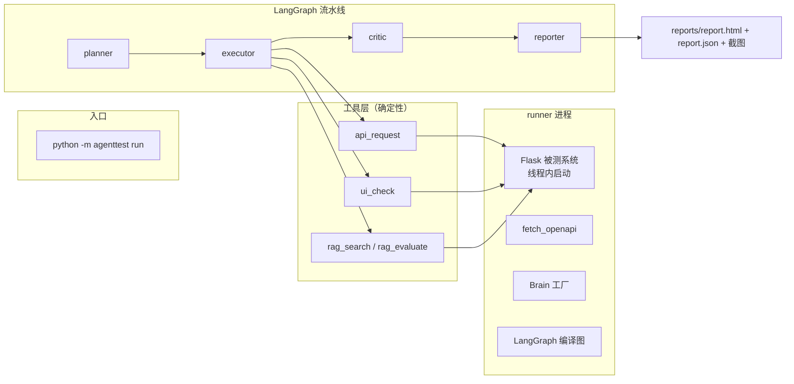

# 架构与设计决策

## 系统全景

## 状态定义（AgentState）

| 字段 | 类型 | 说明 |
| --- | --- | --- |
| goal | str | 本次测试目标 |
| spec | dict | OpenAPI 契约 |
| cases | list[TestCase] | 测试计划 |
| results | list[TestResult] | 执行结果 |
| defects | list[Defect] | 归因缺陷 |
| coverage | dict | 端点→用例映射 |
| trace | Annotated[list, add] | 可追加的思考轨迹 |
| context | dict | 环境上下文（base_url/UI后端等） |
| report | dict | 报告文件路径 |

## 节点职责

- **planner**：调用 Brain.make_plan(spec) → 用例列表；支持 --no-ui 过滤
- **executor**：逐条执行；API 走 requests，UI 走 Chrome 无头，RAG 走 rag_search 并按 `Check.type` 求值检索不变量与指标；5xx/网络错误重试（退避 0.3s×attempt，最多 cfg.max_attempts=3）；记录 attempts/retried/耗时/metrics
- **critic**：Brain.analyze_failures(results) → 缺陷；计算 coverage（API 端点 / UI 页面 / `RAG GET /api/rag/search`）
- **reporter**：组装 TestReport，写 JSON（model_dump_json）与 HTML（Jinja2），截图与报告同目录

## RAG 检索链路（第三类被测对象）

检索链路的正确性无法用状态码表达，因此单独设计了一层「检索不变量 + 质量指标」：

| 组成 | 位置 | 说明 |
| --- | --- | --- |
| 被测检索服务 | `demo_app/rag.py` | 纯标准库 BM25 后端 + `RAG_BUGS` 缺陷开关（默认全开）；可选 embedding 后端延迟导入、失败降级 BM25 |
| RAG 工具层 | `agenttest/tools/rag_tool.py` | `rag_search` / `rag_index` / `rag_reindex` / `rag_add_doc` / `rag_delete_doc` / `rag_evaluate`，风格与 api_tool 一致（`ok` 只表示调用成功，不下业务断言） |
| 指标纯函数 | `agenttest/tools/rag_metrics.py` | `recall_at_k` / `reciprocal_rank` / `mean_reciprocal_rank` / `check_rank_monotonic` / `check_tie_by_doc_id` / `find_duplicate_hits` / `build_report`，无 IO、无依赖；标注集 `LABELED_QUERIES`（7 条查询）也放这里，文档里的指标数字由它复现 |
| 断言类型 | `agenttest/models.py` 的 `Check.type` | `rag_hits_include` / `rag_rank_monotonic` / `rag_tie_by_doc_id` / `rag_no_duplicate` / `rag_recall_at_least` / `rag_mrr_at_least` / `rag_no_ghost_hit` / `rag_status` |
| 归因类别 | `agenttest/models.py` 的 `Defect.category` | 新增 `relevance`，承载召回/排序/索引一致性类失败 |

设计要点：**指标与断言的判定逻辑放在纯函数里**（`rag_metrics.py`），executor 只做「取数据 → 调纯函数 → 组装 TestResult」，因此所有检索不变量都能被 pytest 直接单测，不需要起服务。

实测（k=5，7 条标注查询）：

| 实现 | recall@5 | MRR |
| --- | --- | --- |
| 缺陷实现（默认，`RAG_BUGS` 全开） | 0.5714 | 0.5714 |
| 正确实现（全关） | 1.0000 | 1.0000 |

两行数字由 `agenttest/tools/rag_metrics.py` 的 `LABELED_QUERIES` 复现（`tests/test_rag_engine.py::test_labeled_query_set_reproduces_documented_metrics` 断言 4/7 与 1.0），文档与代码不会漂移。

## Brain 两种实现

| 能力 | MockBrain（规则引擎） | LLMBrain（LangChain） |
| --- | --- | --- |
| 规划 | 内置 28 条正/反/边界/契约用例模板（15 API + 3 UI + 10 RAG） | with_structured_output 生成 12~20 条 |
| 归因 | 规则映射（400→500 契约不符 / 400→200 校验缺失 / 503 flaky / RAG 指标与不变量失败→relevance） | LLM 读失败 JSON 输出缺陷列表 |
| 依赖 | 无 | langchain-openai + API Key |
| 用途 | 离线演示 / CI / 单测 | 智能规划与复杂归因 |

## 关键设计决策

1. **契约即真相**：以 openapi.json 为基准生成契约符合性用例，实现与契约偏差即为缺陷——符合「契约测试」工程实践。
2. **决策/执行分离**：LLM 概率性输出绝不进入断言路径；确定性工具层保证结果可复现。
3. **失败分级**：重试解决「暂时性失败」，归因解决「本质性失败」，两者分离避免统计污染。
4. **可观测优先**：trace 贯穿全流程，报告可审计，演示有说服力。
5. **可移植**：Brain 协议 + OpenAI 兼容接口 + 浏览器抽象，换模型/换被测系统成本低。
6. **检索质量指标化**：RAG 的判定不写成散落的 if，而是沉淀成 `rag_metrics.py` 的纯函数与一组命名断言类型——指标口径（recall@k / MRR 定义）在代码里只有一处，报告、文档、测试共用同一口径，避免「文档说 1.0、代码算 0.5」这类漂移。

## 测试策略（项目自身的质量保障）

| 层级 | 文件 | 覆盖 |
| --- | --- | --- |
| 单元 | test_mock_brain.py / test_report.py | 规划与归因逻辑、报告渲染 |
| 单元（检索） | test_rag_engine.py | BM25 后端、分词、指标纯函数、排序/去重不变量 |
| 集成 | test_api_tool.py / test_ui_tool.py | 工具对真实服务的调用 |
| 集成（检索） | test_rag_tool.py | rag_search / rag_evaluate 对真实 RAG 端点的调用与指标汇总 |
| 功能 | test_demo_app.py | 被测系统行为 + 2 项缺陷 xfail 基准 |
| 功能（检索） | test_rag_sut.py | RAG 端点契约、语料增删改、索引一致性、6 个缺陷的 HTTP 级复现 + 正确实现对照组 |
| 端到端 | test_runner_e2e.py | 全流程必须发现 contract+bug 缺陷并产出报告 |

> 缺陷基准用例的既定约定：`@pytest.mark.xfail(strict=True)` 包住「断言契约期望行为」的用例，缺陷存在则 xfail、被修好则 XPASS 失败提醒；另有「钉住当前实际行为」的用例（直接断言缺陷现状，如 `assert ids == ["DOC-EN-001", "DOC-EN-001"]`），用于在缺陷被修复时也给出明确的失败信号。
